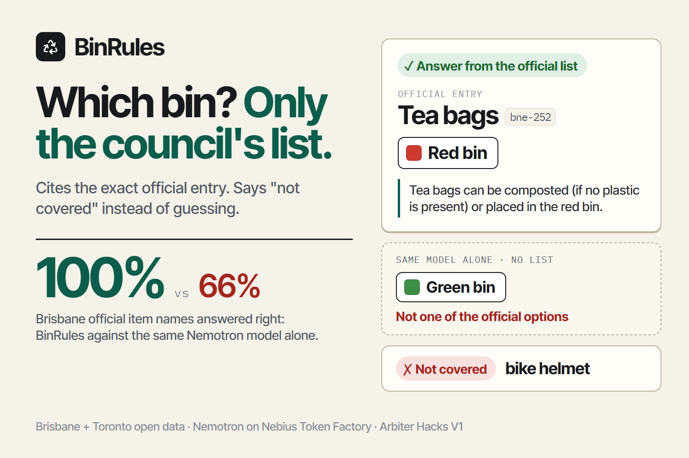

# BinRules



**Which bin? Only what your council's own list says.**

BinRules answers "which bin does this go in?" strictly from a city's official sorting list. It shows the exact official entry it used, with a link to the source, and it says "not covered" instead of guessing when the list does not name the item.

- Live demo: https://binrules.vercel.app
- Built for Arbiter Hacks V1, Rethinking Waste track. MIT licence.
- Cities: Brisbane (294 entries, CC BY 4.0, updated 2026-07-20) and Toronto (2,206 entries, a 2023 snapshot).

## Why this exists

Sorting rules are set by each city, often by the contract with the local processing plant, so the same item goes in different bins in different places. A pizza box is a yellow-bin item in Brisbane. In Toronto it is Blue Bin if unsoiled and Green Bin if food-soiled. A model that answers from general knowledge will pick one bin with confidence and be wrong for a third of items, as the results below show.

Wrong-bin sorting is what contaminates recycling. In the United States the average contamination rate at the processing plant is about 17% by weight, and only about a third of communities know their own number (Recycling Partnership, 2020 Curbside Report, via Waste360). I did not measure anything about real residents. What I can measure is whether an answer is backed by the council's own entry, and that is what this project does.

## Results

Same model on both sides, test questions frozen before tuning. Details, confidence intervals, every failure and every disclosure are in [eval/RESULTS.md](eval/RESULTS.md).

<!-- RESULTS:START -->
Same Nemotron model on both sides, Brisbane test questions frozen before tuning:

| | BinRules | Model alone |
|---|---|---|
| Official item names answered correctly (n = 195) | **100.0%** | 66.2% |
| Messy phrasing answered correctly (n = 136) | **86.0%** | 67.6% |
| Messy phrasing answered wrongly | 1.5% | 32.4% |
| Items the list does not cover that it refused (n = 67) | **94.0%** | 4.5% |

Toronto (smaller, 2023 data): official names 100.0% vs 73.3%; items not covered refused 68.8% vs 9.4%. Full tables, failures and disclosures: [eval/RESULTS.md](eval/RESULTS.md).
<!-- RESULTS:END -->

## What the model does, and what it does not

The model only maps words to entries. It never sees the bins, and it never writes the answer.

1. **Read the words.** Nemotron rewrites "greasy box my pizza came in" into plain item names. No disposal advice.
2. **Retrieve.** Code runs a word index (BM25 with typo tolerance) over the official entry names and pulls the closest 14 entries.
3. **Point.** Nemotron is shown the entry names, in two different orders, and says which one names the same item, or none. Related is not enough: a part, a container, a different item made of the same material, or a broader category the entry does not name all count as "none".
4. **Check.** Code requires that both orderings agree, that the pick shares a word with what the resident wrote, and that a separate yes/no question about the final pick comes back "yes". Any failure ends in "not covered".
5. **Answer.** Code reads the bins and the official note from the entry. If the item has condition variants ("good condition", "poor condition", "unsoiled", "food-soiled") and the resident's own words do not choose one, all variants are shown.

Because the model's only output is an entry number, an instruction hidden in the resident's text cannot produce a bin. There is a test for it.

When the daily budget is spent or the model is unreachable, the site switches to a labelled word-for-word lookup that needs no model.

## Code map

| Path | What it is |
|---|---|
| `lib/engine.ts` | the pipeline above, plus the no-model fallback |
| `lib/retrieve.ts`, `lib/text.ts` | word index, stemming, typo tolerance |
| `lib/baseline.ts` | the "model alone" comparison, frozen before tuning |
| `lib/llm.ts` | Nemotron on Nebius Token Factory (OpenAI-compatible), prices, spend guard |
| `lib/budget.ts` | per-IP and daily caps for the public demo |
| `app/api/ask/route.ts` | the API: saved examples, cache, caps, labelled fallback |
| `data/*.json` | the cities' official entries, normalised by `scripts/build-data.mjs`, wording untouched |
| `eval/` | frozen cases, harness, judge, report generator, raw results |

## Data and licences

| City | Source | Licence | Notes |
|---|---|---|---|
| Brisbane | [What goes in my bin](https://data.brisbane.qld.gov.au/explore/dataset/what-goes-in-my-bin/), Brisbane City Council | CC BY 4.0 | 294 entries, modified 2026-07-20. Each answer links to the exact record. |
| Toronto | [Waste Wizard](https://open.toronto.ca/dataset/waste-wizard-lookup-table/), City of Toronto Open Data | Open Government Licence - Toronto (the portal default; the dataset's own metadata says "licence not specified") | A 2023-11-27 snapshot, so some rules may have changed. |

BinRules is an independent student project and is not affiliated with either city. For hazardous items, ask the council first.

## Evaluation protocol

- **Same model on both sides.** `nvidia/nemotron-3-super-120b-a12b` on Nebius Token Factory, temperature 0, no thinking phase. The "model alone" side gets the city's bin labels with a one-line description each and may answer UNSURE, so it is not punished for being unable to refuse.
- **Questions frozen before tuning.** `eval/cases/*.json` and the baseline prompt are hashed in `eval/FROZEN.json`; a test fails if they change. Tuning used only the dev split (30% of entries by hash of the entry id).
- **Four kinds of question.** Official names asked word for word. Messy phrasing I wrote (slang, typos, brand names, long descriptions). Items the list does not name, plus non-items and an injection attempt. Held-out entries: the entry is deleted from the knowledge base and its own name is asked.
- **Scoring is strict for BinRules and generous for the model.** BinRules is right only if it cites an entry I accepted. The model alone is right if its bin appears anywhere in the official entry's options.
- **One results file.** `eval/results/final.json` holds every raw row. `npm run report` generates `eval/RESULTS.md` and the table above from it, and `tests/results.test.ts` fails if either drifts from the JSON.
- **Disclosures.** Two bugs found after test runs forced two re-runs of the whole test split. The first-run numbers are kept in the report. The out-of-scope labels are my own and nobody else checked them; some Toronto labels turned out to be arguable.

Reproduce (needs your own `NEBIUS_API_KEY`; a full Brisbane test run costs about $0.23):

```bash
npm install
npm test                      # 47 tests, no API calls
npm run eval -- --city brisbane --split test --systems binrules,model --out eval/results/my-run.json
npx tsx eval/show.ts eval/results/my-run.json --wrong
```

## Limits

- It will not answer class-level questions. "Toaster" gets "not covered" plus the nearest entries when the list only says "Household appliances". That is deliberate and it costs recall: about one in eight messy Brisbane questions was declined.
- Two cities. Adding one means normalising its official list into `data/<city>.json`.
- Rules change. Each answer shows the dataset's last-modified date, and the Toronto data is from 2023.
- I measured accuracy against the official lists, not behaviour of real residents or contamination at a plant.
- The hosted model is not bit-for-bit deterministic at temperature 0, so re-runs differ by a couple of points.
- The public demo's caps are per server instance, so the worst case is the daily cap times the number of instances.

## How I would measure whether it works in a real city

Offline accuracy is all I have today. In a pilot, the number to move is plant contamination by weight. Take bin audits (sampled loads sorted by hand) for a pilot neighbourhood and a matched control for a few weeks before launch, then again after, and compare the change in contamination percentage. A cheaper leading signal is the log of "not covered" questions: it is a list of the items residents ask about that the council's own list never mentions, which is something a council can fix.

## Cost

Evaluation and development used about $1.31 of a $2.00 project cap on Nebius Token Factory through the final test runs (ledger in `eval/results/spend.json`; later demo and video checks add a few cents). A live check costs about $0.0005 with the comparison panel on. The public demo is capped at 150 model checks and $0.05 per day per instance.

## Method note

The habit of freezing test questions before tuning and comparing against the same model without the system comes from my earlier hackathon entries. No code is reused, apart from the daily-cap module, which is adapted from my Fair Shift project.
